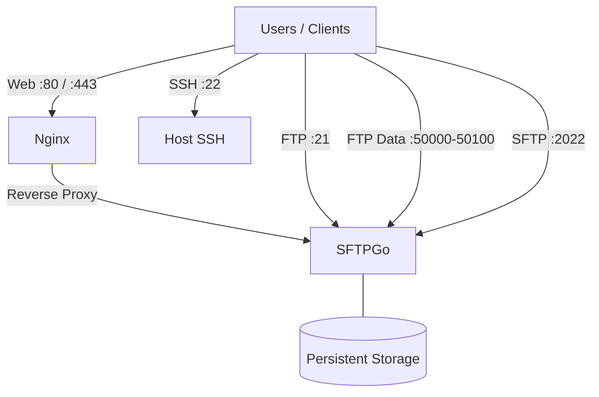

## Why SFTPGo?

I needed a simple FTP server for file transfers, so I looked for a solution that was easy to deploy and maintain.

I chose [SFTPGo](https://github.com/drakkan/sftpgo), an open-source file transfer server that supports SFTP, FTP/S, WebDAV, and a web-based interface.

Instead of configuring everything manually, I created an Ansible role to automate the deployment.

**GitHub:** [ansible-lab (install_sftpgo)](https://github.com/arman-chahardoli/ansible-lab/tree/main/roles/install_sftpgo)

## What does the role do?

The `install_sftpgo` role automates deployment using Docker and configures Nginx as a reverse proxy for web access.

The main components are:

- **SFTPGo:** File transfer service and web interface.
- **Docker:** Runs SFTPGo in a container.
- **Nginx:** Provides HTTPS access to the web interface.
- **Ansible:** Automates deployment and configuration.

The role uses Jinja2 templates and variables to keep the configuration reusable across environments.

## Architecture



## Before deployment

A few things need to be configured before running the role:

- **Docker:** Docker must already be installed. You can use my [my ansible role](https://github.com/arman-chahardoli/ansible-lab/tree/main/roles/install_docker_on_ubuntu) or follow the [official Docker documentation](https://docs.docker.com/engine/install/).
- **Hostname:** The role uses `sftpgo.local` by default with a self-signed TLS certificate. Make sure this hostname resolves to the server's IP address.
- **Firewall:** Allow only the ports required by your deployment.
- **TLS certificate:** The default self-signed certificate enables HTTPS access. For production, replace it with a certificate issued by a trusted CA.

## Firewall ports

| Port        | Protocol | Purpose                      |
|-------------|----------|------------------------------|
| 80          | TCP      | HTTP to HTTPS redirect       |
| 443         | TCP      | HTTPS web interface          |
| 2022        | TCP      | SFTP                         |
| 21          | TCP      | FTP control connection       |
| 50000–50100 | TCP      | Passive FTP data connections |

The FTP passive port range must match the server configuration. Open these ports only if FTP is enabled and required.

## Customizing SFTPGo

This deployment uses a **customized SFTPGo configuration**, rather than relying entirely on the default settings.

You can customize [sftpgo.json](https://github.com/arman-chahardoli/ansible-lab/blob/main/roles/install_sftpgo/files/sftpgo.json) to adjust server settings, protocols, authentication, connection limits, and other supported options. Update the configuration used by the role and recreate or restart the container as required to apply changes.

## Accessing the Web UI

Open the WebAdmin interface at `https://sftpgo.local/web/admin`.

On the first visit, create the initial administrator account if prompted, then log in.

The WebClient is available at `https://sftpgo.local/web/client`.


After logging in, you can access the WebClient:


## Updating the TLS certificate

Copy the new certificate chain and private key to the SFTPGo SSL directory:

```bash
cp fullchain.pem /opt/sftpgo/ssl/sftpgo.crt
cp privkey.pem /opt/sftpgo/ssl/sftpgo.key
```

Restart the Nginx container to apply the changes:

```bash
cd /opt/sftpgo/docker-compose
docker compose restart nginx
```

## Conclusion

This Ansible role provides a simple way to deploy SFTPGo with Docker and Nginx. The customized configuration and reusable templates make it easier to adapt the deployment to different environments.

**GitHub:** [ansible-lab (install_sftpgo)](https://github.com/arman-chahardoli/ansible-lab/tree/main/roles/install_sftpgo)
